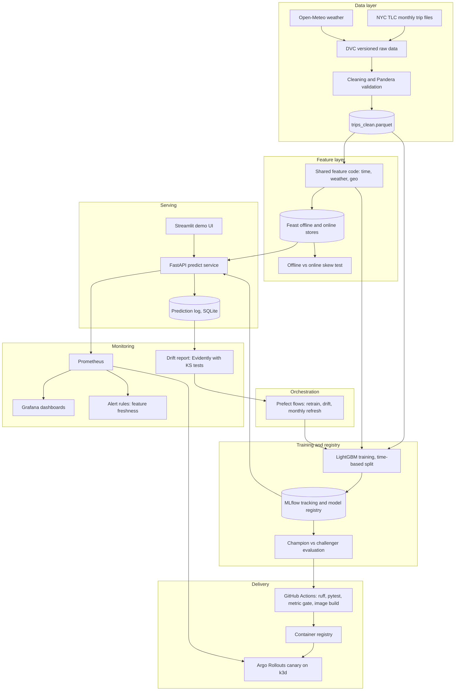
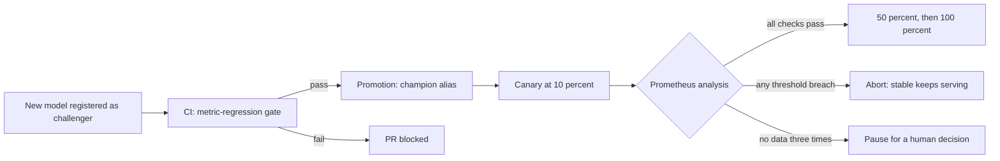

# WhenTaxi

**An end-to-end MLOps platform for taxi trip ETA prediction.**
Versioned data, a feature store, gated CI, canary rollouts that roll back on their own, and drift monitoring, built around a deliberately simple LightGBM model.

[](https://github.com/amizh-labs/WhenTaxi/actions/workflows/ci.yml)


> **Scope note.** WhenTaxi is a *replay-driven* platform. It trains and evaluates on real NYC TLC trip records, takes live weather for near-present timestamps, and refreshes monthly as TLC publishes new files. It is not a live ETA service: no free source streams real taxi trips. See [Limitations](#limitations).

---

## Table of contents

1. [Overview](#overview)
2. [Architecture](#architecture)
3. [Tech stack](#tech-stack)
4. [Results and metrics](#results-and-metrics)
5. [ML design](#ml-design)
6. [MLOps lifecycle](#mlops-lifecycle)
7. [Monitoring and alerting](#monitoring-and-alerting)
8. [API reference](#api-reference)
9. [Getting started](#getting-started)
10. [Demos](#demos)
11. [Repository structure](#repository-structure)
12. [Testing and quality](#testing-and-quality)
13. [Limitations](#limitations)
14. [Roadmap](#roadmap)
15. [Project status](#project-status)
16. [Team and ownership](#team-and-ownership)
17. [Data sources](#data-sources)
18. [Operational reference](#operational-reference)

---

## Overview

Given a pickup zone, a dropoff zone, and a pickup time, WhenTaxi predicts the trip duration in minutes. The model is a LightGBM regressor. The point of the project is everything around it:

| Concern | What the platform does |
|---|---|
| Data quality | Cleans raw TLC files with per-rule drop reporting and Pandera schema validation |
| Reproducibility | DVC versions the raw data; `dvc repro` rebuilds the cleaned table |
| Training and serving consistency | One shared feature module, a Feast feature store, and an automated offline vs online skew test |
| Experiment tracking | MLflow runs, metrics, artifacts, and a model registry with `champion` and `challenger` aliases |
| Change safety | A CI metric-regression gate and an Argo Rollouts canary that aborts automatically on bad releases |
| Observability | Prometheus metrics, Grafana dashboards, drift reports on real requests, and feature-freshness alerts |
| Automation | Prefect flows for retraining and scheduled drift checks, plus a monthly data refresh flow (see [Project status](#project-status)) |

### Key features

- **Leakage-free modeling.** Post-trip fields (`trip_distance`, fare, total, tip) are never used. Evaluation is a strict time-based split.
- **Training-serving skew test.** CI fails if offline and online feature values differ for the same entity and timestamp.
- **Fail-closed canary analysis.** Empty or NaN metrics can never count as a pass.
- **Fail-open request logging.** The prediction log cannot slow down or break `/predict`.
- **Size-aware drift detection.** Per-column KS tests with an effect-size floor, calibrated against a measured false-alarm rate.
- **Explicit data-quality signals.** A missing weather feed is reported as a data-quality alert and never as drift.

---

## Architecture



### Release flow



### Components

| Component | Responsibility | Location |
|---|---|---|
| Cleaning and validation | Drop out-of-month, impossible-duration, and unknown-zone trips; write a per-rule report | `src/validation/` |
| Feature module | One function for time, weather, and geo features, shared by training and serving | `src/features/` |
| Feature store | Rolling zone-pair features, offline and online stores, freshness metadata | `src/features/store/` |
| Training | Zone-pair baseline, LightGBM, time-based split, MLflow logging and registration | `src/training/` |
| Evaluation | Champion vs challenger comparison, error analysis, CI metric gate, promotion | `src/evaluation/` |
| Serving | FastAPI `/predict`, live weather with fallback, Prometheus metrics, prediction log | `src/serving/` |
| Monitoring | Drift on logged requests, traffic simulator, surge demo, alert rules, Grafana | `monitoring/` |
| Flows | Retrain, scheduled drift check, processed-months state, monthly refresh | `flows/` |
| Cluster | k3d manifests, Argo Rollout, analysis template, demo driver | `k8s/` |
| Demo UI | Streamlit page that calls the API | `ui/` |

---

## Tech stack

| Layer | Tools | Role |
|---|---|---|
| Language and packaging | Python 3.11, `pyproject.toml` with version bounds (for example `pandas<3`) | Reproducible installs |
| Data versioning | DVC | Versioned raw data and the `clean` pipeline stage |
| Data validation | Pandera, pandas, PyArrow | Schema checks and cleaning |
| Feature store | Feast (SQLite offline and online stores) | Rolling zone-pair features, point-in-time correctness |
| Modeling | LightGBM, scikit-learn | Regression model and metrics |
| Experiment tracking and registry | MLflow 3.x (SQLite backend) | Runs, artifacts, `champion` and `challenger` aliases |
| Serving | FastAPI, Uvicorn, Docker | Prediction API and container image |
| Orchestration | Prefect | Retrain, drift, and refresh flows |
| CI/CD | GitHub Actions, GitHub Container Registry | Lint, tests, metric gate, image build |
| Deployment | k3d (Kubernetes in Docker), Argo Rollouts | Canary rollout with automatic rollback |
| Metrics and dashboards | Prometheus, Grafana | Latency, errors, prediction and feature-age metrics |
| Drift detection | Evidently, SciPy (KS tests) | Drift reports on logged requests |
| Demo UI | Streamlit (separate image) | Try the API in a browser |
| Quality | pytest, Ruff | 290+ tests (plus 16 UI tests) and linting |
| External data | NYC TLC trip records, TLC zone shapefile, Open-Meteo | Trips, zone geometry, weather |

All tools are free and open source. The platform runs on a single laptop (24 GB RAM recommended for the full cluster demo).

---

## Results and metrics

All numbers below were measured on real data. The validation month is **March 2026**, a month the models never trained on. Training data is January and February 2026.

### Data volumes (after cleaning)

| Split | Months | Cleaned trips |
|---|---|---|
| Train | Jan-Feb 2026 | 6.92 M |
| Validation | Mar 2026 | 3.84 M |
| Holdout (surge and refresh demos) | Apr 2026 | about 3.7 M |

### Model performance on March 2026

| Model | MAE (min) | RMSE (min) | p90 abs error (min) |
|---|---|---|---|
| Always predict the median (13.5 min) | 9.10 | n/a | n/a |
| Zone-pair mean baseline | 4.75 | 7.63 | 9.67 |
| LightGBM, 12 features, squared error | 3.88 | 6.46 | 7.95 |
| LightGBM, geo features and L1 objective (the shipped champion) | **3.79** | 6.55 | 7.82 |

The champion is about 20% better than the baseline on MAE. L1 optimizes MAE directly, which is why its RMSE is slightly above the squared-error model's.

### Ablation (two time-based folds, 2M-row training samples)

Fold A trains on January and validates on February. Fold B trains on January-February and validates on March.

| Variant | Fold A MAE | Fold B MAE | Mean MAE |
|---|---|---|---|
| 12 features, squared error | 4.1305 | 3.9407 | 4.0356 |
| plus geo features | 4.0553 | 3.8589 | 3.9571 |
| plus geo features and **L1** | 4.0310 | 3.8127 | **3.9218** |
| plus geo features and Huber (delta 5 min) | 4.0345 | 3.8108 | 3.9226 |
| plus geo features and log1p target | 4.0516 | 3.8248 | 3.9382 |

Geo features give about 2.0% lower MAE, and the L1 objective adds about 0.9%. L1 and Huber are a statistical tie.

### Error by slice (fold B, champion configuration)

| Slice | Trips | MAE (min) |
|---|---|---|
| Manhattan | 3.31 M | 3.35 |
| Queens | 330 k | 6.12 |
| Brooklyn | 158 k | 7.10 |
| Bronx | 39 k | 9.92 |
| Non-airport trips | 3.55 M | 3.64 |
| Airport trips | 294 k | 5.92 |

Airport trips are the one slice where the geo and L1 changes did not help (5.87 before, 5.92 after). The Staten Island and EWR slices are too small to interpret.

### Feature importance (by gain)

| Feature group | Share |
|---|---|
| `avg_duration_24h` | about 66% |
| Zone-to-zone distance | about 10% |
| Hour of day | about 6% |
| `avg_duration_1h` | about 6% |
| Weather (all four columns) | 1.7% |

The model is largely **weather-insensitive**: weather features account for 1.7% of importance, and the training months contain almost no extreme weather to learn from.

### Month-over-month check

The champion scored **4.08 MAE on the full April 2026 holdout**, 7.7% worse than March. This is the reason the platform re-evaluates on every newly published month.

### Canary analysis thresholds

| Check | Condition for a pass |
|---|---|
| p95 request latency (canary pods only) | below 0.5 s |
| 5xx error rate | below 2% |
| Mean predicted ETA vs the stable version | within 25% |
| Missing or NaN metric | never a pass |

In a fault-injection test on an earlier manifest revision, a release with predictions multiplied by 3 read a canary/stable ratio of 2.08, 2.25, and 2.32 against a limit of 0.25 and was aborted while latency and error rate stayed clean. The good and bad runs were then repeated on the final manifests (sanity comparison over a 3-minute window): a healthy release promoted to 100%, and a faulty one was aborted and rolled back.

### Drift detector calibration

False-alarm rate measured by drawing 50 random windows from the reference data itself:

| Window size | `dataset_drift` fired |
|---|---|
| 200 rows | 2% (1 of 50) |
| 500 rows | 0% (0 of 50) |
| 2000 rows | 0% (0 of 50) |

Evidently's default distance threshold fired in 26 of 50 windows at 200 rows, so per-column KS tests (p < 0.003) with an effect-size floor are used instead.

### Evening-rush surge demo (2,000 replayed trips per window)

| Window | MAE (min) | Dataset drift | Drifted trigger columns |
|---|---|---|---|
| Baseline (April as is) | 4.03 | false | none |
| Surge (evening and airport heavy) | 10.91 (against synthetic, inflated durations) | true | `hour`, `distance_km` |

The surge MAE is built in by construction (durations inflated by 40%) and is not a performance figure. The demo shows detection and retraining, not model adaptation.

---

## ML design

**Target.** `duration_min = dropoff time - pickup time`, kept between 1 and 180 minutes.

**Cleaning rules** (each reported separately in `data_quality_report.json`):

1. Pickup must fall inside the file's own month (raw files contain out-of-month pickups, including timestamps from 2008).
2. Dropoff must be after pickup and the duration within 1 to 180 minutes.
3. Both zone IDs must exist in `taxi_zone_lookup.csv`.
4. Rows pointing to "Unknown" or "Outside of NYC" zones are dropped under their own rule.

**Features available at request time only**

| Group | Features |
|---|---|
| Location | Pickup zone and dropoff zone (categorical, fixed category list from the lookup table) |
| Time | Hour, day of week, weekend flag |
| Weather | Temperature, precipitation, snowfall, wind speed (Open-Meteo hourly) |
| Rolling traffic (Feast) | Average duration over the last 1 hour and 24 hours, trip count over 24 hours, per zone pair, computed point-in-time |
| Geo | Haversine distance and bearing between zone centroids, same-zone flag, borough pair, airport flag |

**Modeling rules**

- Time-based split only, never random.
- No post-trip fields: `trip_distance`, `fare_amount`, `total_amount`, and `tip_amount` are banned and checked by `scripts/verify.py`.
- Always compare against the zone-pair-mean baseline.
- Feature code lives in one module imported by both training and serving.
- Zone category lists are fixed from the lookup table, so an unseen zone at serving time never silently shifts category codes.

**Model.** LightGBM regressor with the L1 objective, tuned to the headline metric (MAE).

---

## MLOps lifecycle

### Data and features

- `data/raw` is tracked by DVC (`data/raw.dvc`). The `clean` stage in `dvc.yaml` builds `data/processed/trips_clean.parquet`, and a second `dvc repro` is a no-op until inputs change.
- Feast materializes rolling zone-pair features. `materialized.json` records when, and the API exports the store's age as a metric.
- The skew test compares offline and online feature values for the same entity and timestamp.

### Experiment tracking and registry

- Every training run logs parameters, baseline and model metrics, feature importance, the data-quality report, and the train and validation months to MLflow.
- Registered model name: `eta-duration`. The newest version gets the `challenger` alias. The `champion` alias is only ever moved by promotion logic.

### CI

On every push and pull request, GitHub Actions:

1. Installs the project from a clean environment.
2. Runs Ruff and the full pytest suite.
3. Trains the shipped configuration on a fixed sample and **fails if MAE regresses** against a stored reference file.
4. Builds the serving image (and publishes it on merge to `main`).
5. Runs the UI tests in a separate job that installs only `ui/requirements.txt`, and fails on any skipped test.

### Progressive delivery

Argo Rollouts shifts traffic 10%, then 50%, then 100% with timed pauses. A background analysis queries Prometheus for the canary pods only. Real threshold breaches fail on the first measurement. Empty or NaN results are *inconclusive*: after three, the rollout pauses for a human, so a canary with no data is never promoted and never silently passes.

### Automation

| Flow | Purpose |
|---|---|
| `flows/retrain.py`, `flows/training_flow.py` | Train and register a challenger; retrain when drift or an accuracy flag fires |
| `flows/drift_flow.py` | Daily drift check on the prediction log (`--serve` schedules it at 06:00) |
| `flows/month_state.py` | Atomic state file of processed months, updated only after a month fully succeeds |
| `flows/refresh_flow.py` | Monthly refresh: detect a newly published month, clean, score the champion, retrain (written and mock-tested; not yet run on real data) |

---

## Monitoring and alerting

### Prometheus metrics (exported by the API)

| Metric | Type | Meaning |
|---|---|---|
| `eta_request_latency_seconds` | histogram | End-to-end `/predict` latency |
| `eta_requests_total` | counter (label `status`) | Requests by HTTP status |
| `eta_prediction_minutes` | histogram | Distribution of predicted ETAs |
| `eta_feature_age_seconds` | gauge | Seconds since the Feast online store was materialized (-1 if unknown) |
| `eta_feature_age_alert_threshold_seconds` | gauge | Configured staleness threshold |

### Alert rules

| Alert | Fires when |
|---|---|
| `EtaFeaturesStale` | Feature age exceeds the threshold (default 7 days) |
| `EtaFeaturesUnknown` | The feature store was never materialized or its metadata is unreadable |

### Grafana dashboard

Request rate, p95 latency, 5xx ratio, share of predictions over 30 minutes, feature age vs threshold, firing alerts, and a predicted-ETA distribution heatmap. Drift is not on the dashboard: the API exports no drift metrics, so drift lives in the drift reports.

### Drift detection

`monitoring/prediction_drift.py` compares the logged request window against a 20,000-row Jan-Feb reference.

- **Trigger columns** (can set `dataset_drift`): `hour`, day of week, and `distance_km`.
- **Context columns** (reported, never trigger): the four weather columns.
- **Data quality** (separate alert): share of requests with missing weather, flagged above 20%.
- Fewer than 200 logged rows returns `insufficient data` and never flags drift.

---

## API reference

### `POST /predict`

```json
{
  "pickup_zone": 161,
  "dropoff_zone": 237,
  "pickup_ts": "2026-03-10T08:30:00"
}
```

```json
{
  "eta_minutes": 8.4,
  "model_version": "1",
  "weather_source": "archive"
}
```

Optional fields let a caller supply the four weather values directly.

| `weather_source` | Meaning |
|---|---|
| `request` | Supplied by the caller |
| `live` | Current Open-Meteo forecast for a pickup time from yesterday to two days ahead |
| `archive` | Stored historical weather file |
| `missing` | No weather available; the model receives missing values |

Weather resolution order: request, live, archive, missing. A 2-second timeout and a short failure memory mean a weather outage cannot stall requests.

### `GET /metrics`

Prometheus exposition format (metrics above).

### `GET /docs`

Interactive OpenAPI documentation (FastAPI).

---

## Getting started

### Prerequisites

- Python 3.11
- Docker Desktop with the WSL 2 backend (Windows) or Docker Engine (Linux/macOS)
- For the cluster demo: `kubectl`, `k3d`, and the `kubectl-argo-rollouts` plugin, run inside WSL 2 or Linux

### 1. Install

```bash
git clone https://github.com/amizh-labs/WhenTaxi.git
cd WhenTaxi
python3 -m venv .venv && source .venv/bin/activate
pip install -e ".[dev,serving,flows,monitoring]"
```

### 2. Get the data

```bash
python scripts/download_data.py        # TLC trips, zone lookup, weather
dvc add data/raw                       # track it (identical files give an identical hash)
dvc repro                              # clean stage: writes data/processed/trips_clean.parquet
```

### 3. Verify the pipeline

```bash
pytest -q && ruff check .
python scripts/verify.py               # leakage, time split, weather NaN rate, baseline, seed, unseen zone
```

### 4. Train and serve

```bash
python -m features.store.materialize   # build the Feast stores
python -m training.train --geo --objective l1
docker compose up --build              # MLflow, API, Prometheus, Grafana, UI
```

When training against the Compose MLflow, set `MLFLOW_TRACKING_URI=http://localhost:5000` first.

| Service | URL |
|---|---|
| API and docs | http://localhost:8000 and http://localhost:8000/docs |
| MLflow | http://localhost:5000 |
| Prometheus | http://localhost:9090 |
| Grafana | http://localhost:3000 |
| Demo UI | http://localhost:8501 |

```bash
curl -s -X POST localhost:8000/predict \
  -H 'content-type: application/json' \
  -d '{"pickup_zone":161,"dropoff_zone":237,"pickup_ts":"2026-03-10T08:30:00"}'
```

The exact end-to-end command sequence, with expected output for each step, is in `docs/RUNBOOK.md`.

### 5. Canary demo on Kubernetes (WSL 2)

```bash
python k8s/demo.py up
python k8s/demo.py build
python k8s/demo.py train
python k8s/demo.py deploy --replicas 5
python k8s/demo.py good        # a healthy release promotes to 100%
python k8s/demo.py bad         # predictions inflated 3x: analysis aborts, stable keeps serving
python k8s/demo.py down
```

`--replicas 5` halves memory use. Without a service mesh, traffic splits by pod count, so at 5 replicas the canary steps are approximately (not exactly) 10, 50, and 100%. Use 10 replicas for exact steps.

---

## Demos

### Evening-rush surge (platform detects a shift and retrains)

```bash
python -m monitoring.surge_demo
```

Replays held-out April 2026 trips through `/predict` in two windows: as they are, and resampled toward evening hours with more airport trips (durations inflated 40%, labelled synthetic). Drift comes from the API's request log. MAE is computed offline with point-in-time features, because scoring replayed history through the live API would mix in the stale-snapshot effect described under Limitations. When drift or the MAE flag fires, the existing retrain flow trains a challenger against a throwaway registry; the real registry and `champion` alias are never touched. Output: a summary table and `data/processed/surge_demo_report.json`. It needs the April file at `data/holdout/yellow_tripdata_2026-04.parquet` (git-ignored); the commands are in `docs/RUNBOOK.md`.

### Streamlit UI

A page for trying the API: choose pickup and dropoff zones and a date and time, and it shows the predicted minutes, model version, weather source, the straight-line distance between zone centroids, a map, and a session history. It lives in `ui/` with its own requirements and image and is never imported by `src/`.

```bash
docker compose up --build   # then open http://localhost:8501
```

It is a replay demo, not a live ETA service. Tests: `pip install -r ui/requirements.txt pytest`, then `pytest ui/tests`.

---

## Repository structure

```
.
├── src/
│   ├── validation/        # cleaning rules, Pandera schema, drop report
│   ├── features/          # shared feature code, geo, rolling, freshness, Feast store
│   ├── training/          # baseline, LightGBM, metrics, MLflow registry
│   ├── evaluation/        # compare, error analysis, CI gate, promotion
│   └── serving/           # FastAPI app, live weather, prediction log
├── flows/                 # Prefect flows: retrain, drift, month state, refresh
├── monitoring/            # drift jobs, simulator, surge demo, alerts, Prometheus, Grafana
├── k8s/                   # k3d manifests, Argo Rollout, analysis template, demo driver
├── ui/                    # Streamlit demo UI (separate image, own requirements and tests)
├── scripts/               # data download, zone centroids, verify, UI zone list
├── data/
│   ├── raw/               # DVC-tracked inputs (not in git)
│   └── reference/         # zone_centroids.csv (committed, small)
├── docs/                  # RUNBOOK.md and handoff notes
├── tests/                 # pytest suite
├── .github/               # workflows, CODEOWNERS, metric reference files
├── dvc.yaml               # clean stage
├── docker-compose.yml     # local stack
├── Dockerfile             # serving image
└── pyproject.toml
```

The interfaces between components (cleaned-table schema, registered model name, `/predict` JSON, metric names, drift report format) are defined in `docs/contracts.md`, which the two owners keep out of the repository. Changing a contract requires approval from both owners.

---

## Testing and quality

| Check | What it covers |
|---|---|
| `pytest` | 290+ tests: cleaning rules, features and geo, skew test, training and registry, gate, promotion, API behavior, live weather (mocked HTTP), prediction log, drift calibration, surge demo, manifests, Dockerfile, DVC config |
| `pytest ui/tests` | 16 UI tests (Streamlit `AppTest`, mocked HTTP), run in their own CI job from a clean environment |
| `ruff check .` | Linting |
| `scripts/verify.py` | Six correctness checks on real data: no leakage columns, time split ordering, weather NaN rate under 1%, model beats baseline, seed reproducibility, unseen-zone prediction |
| CI metric gate | Fails a PR if the trained model's MAE regresses against `.github/metric_reference_real.json` |
| Manifest tests | Canary steps, metric names, fail-closed analysis conditions, read-only mount guards |

No test touches the real network; HTTP is mocked and a guard fixture makes any real call fail.

---

## Limitations

- **Replay, not live.** Trips are historical TLC files published monthly with a lag. Only the weather input can be live, and only for pickup times near today.
- **Rolling features come from one snapshot.** `/predict` reads `avg_duration_1h`, `avg_duration_24h`, and `trip_count_24h` from the Feast online store as of the last materialization and ignores `pickup_ts`. Against point-in-time values on March trips, `avg_duration_24h` differs by about 2 minutes on average, and the 1-hour feature is present for 62% of requests versus 74% point-in-time. These features carry about 72% of model importance, so served predictions on historical timestamps are not directly comparable to the evaluation numbers. For that reason replay MAE is computed offline. The feature-age alerts exist to expose staleness.
- **The model is largely weather-insensitive** (1.7% of importance). The platform detects distribution shifts; the model does not adapt to them.
- **The canary sanity check compares mean predictions.** It catches shifted or broken models but not a model that is wrong trip by trip while matching on average. The held-out evaluation gate covers that case.
- **Inconclusive canaries pause for a human** instead of rolling back automatically. A canary with no data is never promoted, but someone must run `abort` or `promote`.
- **Replica-count approximation.** Canary percentages are exact only at 10 replicas.
- **Thresholds are not tuned to this data.** For example, the day-of-week drift floor (0.10) sits close to the month-to-month weekday-mix difference (about 0.08 to 0.09).
- **Local DVC remote.** The configured remote is a folder on one machine. A fresh clone rebuilds raw data with `scripts/download_data.py`.
- **Single-instance prediction log.** SQLite with one writer; the cluster demo leaves it off and uses Prometheus metrics only.

---

## Roadmap

- Request-time override of rolling features (changes the API contract, needs both owners' approval).
- Scheduled Feast re-materialization to match the existing freshness alert.
- Run the monthly refresh flow on real data, then add the canary step.
- A shared DVC remote.
- A genuinely live variant on a source with a real-time feed and automatically arriving labels, such as bike-share station availability.
- More winter data, then a weather-aware model if weather sensitivity is wanted.

---

## Project status

| Area | Status |
|---|---|
| Cleaning, Pandera validation, DVC `clean` stage | Verified on real data (Jan-Apr 2026) |
| Training, MLflow tracking and registry | Verified on real data |
| Feast stores and skew test | Verified (tests) |
| FastAPI service, live weather, prediction log | Verified locally and on the Compose stack |
| Drift detection, surge demo | Verified on the Compose stack |
| CI on GitHub | Green on `main` through the monitoring commits; the new UI jobs have not been checked yet |
| Canary rollout on k3d | Good and bad runs verified on the final manifests |
| Monthly refresh flow | Written and tested with mocks; not yet run on real data |
| Streamlit UI | Verified in a browser on the Compose stack (prediction, map, API-down error); the 422 and timeout messages are covered by mocked tests only |
| Demo recording | Pending |

---

## Team and ownership

WhenTaxi is built by two equal contributors, each owning half of every domain. Ownership is enforced through `.github/CODEOWNERS`; `ui/` is owned by both.

| Domain | [@vaishnavi7106](https://github.com/vaishnavi7106) | [@amizh-labs](https://github.com/amizh-labs) |
|---|---|---|
| Data | Feature engineering, weather join, Feast stores, skew test | Ingestion, cleaning, Pandera validation, DVC |
| ML | Evaluation, champion/challenger comparison, promotion | Training, MLflow registry, drift reports |
| MLOps | CI/CD, metric gate, image build | Prefect flows, retrain triggers |
| Deployment | k3d, Argo Rollouts canary, analysis template | FastAPI service, Docker, monitoring, dashboards |

Workflow: pull requests reviewed by the other owner, a short teach-back after each package, and commits made only under each author's own identity.

---

## Data sources

- **NYC TLC Trip Record Data** (yellow taxi, 2026): https://www.nyc.gov/site/tlc/about/tlc-trip-record-data.page
- **NYC TLC Taxi Zone Lookup and Shapefile**, used for zone validation and centroids.
- **Open-Meteo** (historical archive and forecast APIs): https://open-meteo.com

Trip data, zone files, and weather are public. The raw files and the zone shapefile are not committed; `scripts/download_data.py` rebuilds them.

---

## Operational reference

Details for operating the data, prediction log and DVC pieces.

### Data files

- `data/raw/` (DVC-tracked, never in git): TLC yellow-taxi trip files, `taxi_zone_lookup.csv`, Open-Meteo weather.
- `data/reference/zone_centroids.csv` (committed, small): one lat/lon centroid per taxi zone, used by
  `features.geo` for distance and bearing features. Zones 264/265 ("Unknown") have no polygon and are absent.
  - Source: NYC TLC Taxi Zone Shapefile, `https://d37ci6vzurychx.cloudfront.net/misc/taxi_zones.zip`
  - Downloaded: 2026-11-18. The shapefile itself is not committed.
  - Rebuild (rare, needs the optional extra): `pip install -e ".[geo]"` then
    `python scripts/build_zone_centroids.py --download <empty dir>`.

### Prediction log (live / Compose deployment only)

`/predict` can append every call to a SQLite file so real requests can be compared with the training data.

- **Off by default.** Enable with `ETA_PREDICTION_LOG=<path>` (for example `data/prediction_log.sqlite`).
  Optional `ETA_PREDICTION_LOG_MAX_ROWS` (default 100000) keeps only the newest rows.
- **Single-instance only.** The log is meant for the single-container Compose/live deployment. The k3d cluster demo runs
  5-10 API replicas that would fight over one SQLite file, so it leaves the log off and keeps only Prometheus metrics.
- **Columns:** `ts` (UTC), `pickup_zone`, `dropoff_zone`, `pickup_ts`, the four weather values the model used,
  `weather_source` (`request` / `live` / `archive` / `missing`), `eta_minutes`, `model_version`.
- **Cannot hurt `/predict`.** The request only puts a record on a bounded in-memory queue; a background thread writes it
  (WAL mode). A full queue drops records and any write error is swallowed (both are counted); the response is unchanged.
- **Drift on real requests:** `python -m monitoring.prediction_drift --log <path>` compares the logged window with a
  20k-row sample of Jan-Feb 2026 on hour, day of week, the four weather columns and the geo distance between zones
  (raw zone ids are not compared: too many categories and too noisy at a few hundred requests). It writes
  `monitoring/reports/drift_report.json` (contract format, `docs/contracts.md` section 5) and an HTML report.
  With fewer than 200 logged rows it reports `"status": "insufficient data"` and never flags drift.
  Weather in November will honestly differ from January-February, so expect temperature to drift on a live log.

**Drift check caveats.**
- The drift check assumes representative traffic: a log of a few test requests (or one rider type) will look "drifted"
  against the Jan-Feb reference. Demo drift runs therefore replay real trips (`monitoring/simulator.py`, or the surge demo below),
  not hand-sent requests.
- November weather will differ from the Jan-Feb reference. That is why the four weather columns are reported as
  context (`context_drift`) but can never set `dataset_drift`; only hour, day of week and zone distance can.
- Missing weather is a data-quality signal, not drift: the report's `data_quality.share_missing_weather` carries an
  `alert` flag above 20%.
- Compose runs the log on a named volume (`prediction-log`). The daily check is a Prefect flow:
  `python -m flows.drift_flow` (once) or `python -m flows.drift_flow --serve` (daily at 06:00); copy the log out of the
  volume first with `docker compose cp api:/app/log/predictions.sqlite data/prediction_log.sqlite`.

### Data versioning (DVC)

- **What is tracked.** `data/raw` (trip files, zone lookup, weather) is tracked by DVC through `data/raw.dvc`; git
  only holds that small pointer. `data/processed/trips_clean.parquet` is produced by the `clean` stage in `dvc.yaml`,
  with the drop report `data/processed/data_quality_report.json` as its metric file.
- **Track or update the raw data:** `dvc add data/raw`, then commit the changed `data/raw.dvc`.
- **Local remote.** `.dvc/config` points the remote `localremote` at a folder on one machine (`/home/user1/dvc-remote`);
  `dvc push` / `dvc pull` copy data to and from it. It is free and needs no account, but it is not shared between machines.
- **Rebuild the cleaned data:** `dvc repro` runs the `clean` stage. A second run prints "Data and pipelines are up
  to date" and does nothing, until the raw data or `src/validation/clean.py` / `schema.py` change.
- **Fresh clone** (no DVC cache and no access to the other machine's remote): run `python scripts/download_data.py`
  to fetch the raw files, then `dvc add data/raw` to track them, then `dvc repro`. Identical files give an identical hash,
  so `data/raw.dvc` stays unchanged.
